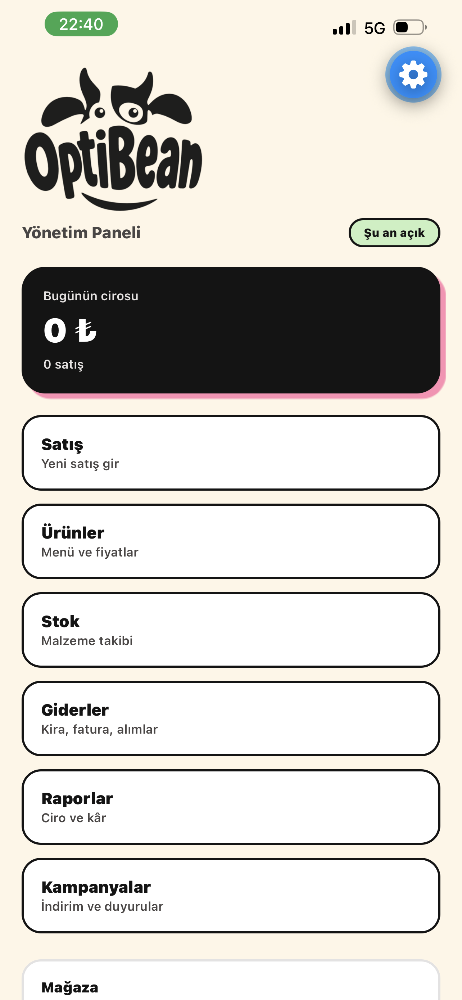
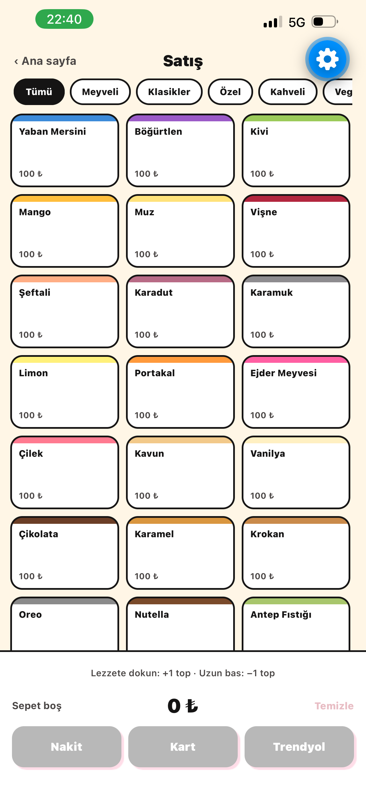
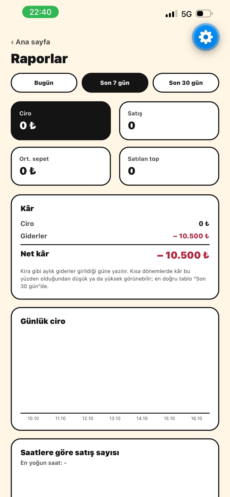
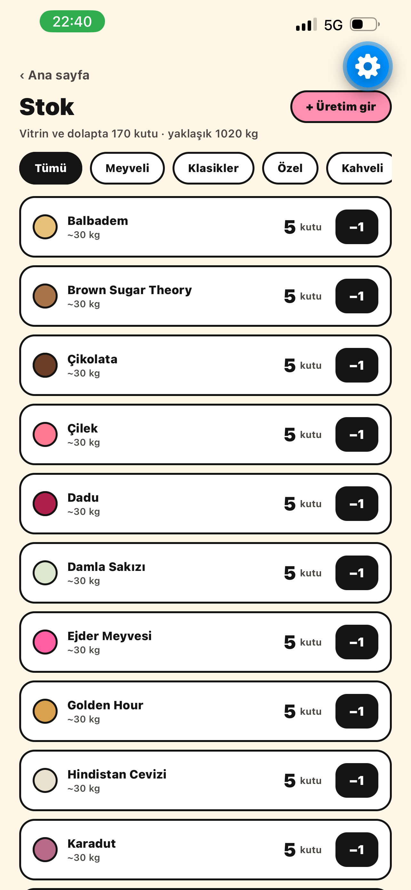
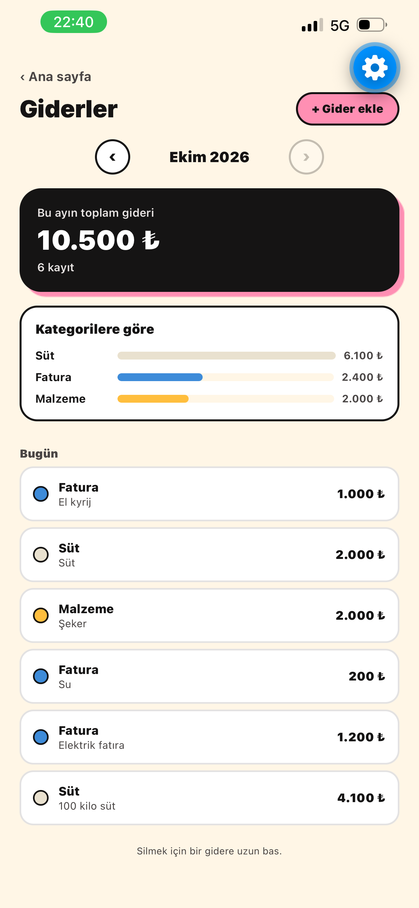
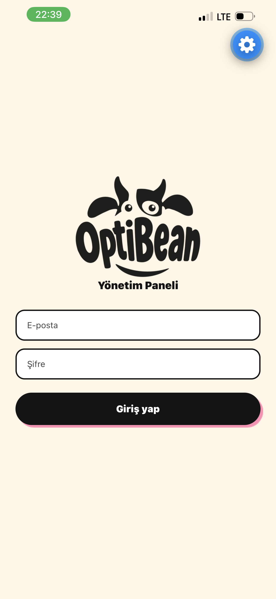
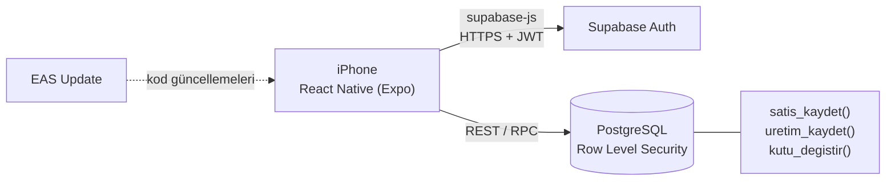
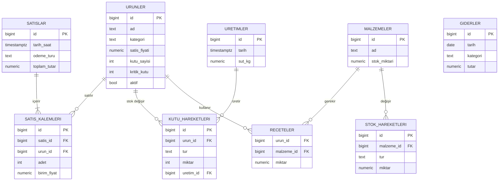

<p align="center">
  
</p>

<h1 align="center">OptiBean Yönetim Uygulaması</h1>

<p align="center">
  İstanbul Çekmeköy'deki dondurma mağazam <b>OptiBean</b> için geliştirdiğim, mağazada her gün kullandığım mobil işletme yönetim sistemi.
</p>

<p align="center">
  
  
  
  
</p>

---

## Problem

Mağazada satışlar bir deftere yalnızca **gün sonu toplamı** olarak yazılıyordu. Bu yüzden şu sorulara cevap verilemiyordu:

- Hangi lezzet ne kadar satıyor, hangisi menüden çıkmalı?
- Günün hangi saatleri yoğun?
- Nakit, kart ve Trendyol Yemek satışlarının payı ne?
- Ay sonunda giderler düşüldükten sonra gerçekte ne kadar kâr kalıyor?
- Hangi lezzetin kutusu bitmek üzere, ne zaman üretim yapılmalı?

## Çözüm

Kağıt üzerindeki süreci dijitale taşıyan, tek kullanıcılı bir mobil uygulama. Her satış tek tek kayda giriyor; raporlar, stok uyarıları ve kâr hesabı bu ayrıntılı veriden otomatik üretiliyor.

## Ekran görüntüleri

| Ana ekran | Satış | Raporlar |
|:---:|:---:|:---:|
|  |  |  |

| Stok | Giderler | Giriş |
|:---:|:---:|:---:|
|  |  |  |

## Özellikler

**Satış (kasa ekranı)**
- İki dokunuşla satış: lezzetlere dokun, ödeme türüne dokun
- Lezzetler son 30 günün satışına göre sıralanır; en çok satanlar hep en üstte
- Kayıt arka planda yapılır; bağlantı koparsa sepet geri gelir, satış kaybolmaz

**Raporlar**
- Bugün / son 7 gün / son 30 gün için ciro, satış sayısı, ortalama sepet
- Günlük ciro grafiği, saatlere göre yoğunluk, en çok satan 10 lezzet
- Ödeme türü ve kategori dağılımı
- **Net kâr** ve kâr marjı (ciro − giderler)

**Kutu bazlı stok**
- Dondurmalar 6 kg'lık kutularda üretiliyor; stok lezzet başına kutu olarak tutulur
- Toplu üretim girişi (örn. 100 kg sütten hangi lezzetten kaç kutu çıktı)
- Kutu bitince tek dokunuşla düşüm, sayım düzeltmesi
- Kritik seviyenin altına düşen lezzetler için ana ekranda uyarı

**Giderler ve ürünler**
- Kategorili gider kaydı, aylık toplam ve dağılım
- Fiyat güncelleme, kategoriye toplu fiyat, lezzeti pasife alma

## Teknik mimari



| Katman | Teknoloji |
|---|---|
| Mobil uygulama | React Native, Expo SDK 57, Expo Router, TypeScript |
| Veritabanı | PostgreSQL (Supabase) |
| Kimlik doğrulama | Supabase Auth (e-posta/şifre, kayıt kapalı) |
| Dağıtım | EAS Update |
| Sürüm kontrolü | Git, GitHub |

## Veritabanı tasarımı



### Tasarım kararları

- **Satış ve satış kalemleri ayrı tablolar (normalizasyon).** Bir satış birden fazla lezzet içerebilir; fişe ait bilgiler (tarih, ödeme türü) her satırda tekrar edilmez.
- **Satış anındaki fiyat kalemde saklanır (`birim_fiyat`).** Fiyat güncellendiğinde geçmiş satışların tutarı ve raporlar değişmez.
- **Stok bir sayı değil, hareket kaydı.** Üretim, kutu bitişi ve sayım düzeltmeleri ayrı satırlar olarak tutulur; stok geçmişi ve tüketim hızı bu kayıtlardan çıkarılabilir.
- **İşlemler (transaction) veritabanı fonksiyonlarında.** `satis_kaydet()` fiş, kalemler ve stok düşümünü tek işlemde yapar; biri başarısız olursa hiçbiri kaydedilmez. Fiyatlar istemciden değil veritabanından alınır.
- **Kısıtlar veritabanında.** `CHECK` kısıtları negatif stoğu, geçersiz ödeme türünü ve sıfır adetli kalemi engeller.

## Güvenlik

- Tüm tablolarda **Row Level Security** açık; veriye yalnızca giriş yapmış kullanıcı erişebilir.
- Yeni kullanıcı kaydı kapalı; sistemin tek kullanıcısı mağaza sahibi.
- Uygulamadaki Supabase anahtarı, istemcide kullanılmak üzere tasarlanmış *publishable* anahtardır. Tek başına veri erişimi sağlamaz.
- Veritabanı fonksiyonlarını çalıştırma yetkisi anonim kullanıcılardan alınmıştır.

## Proje yapısı

```
src/
├── app/
│   ├── _layout.tsx        # Kök düzen
│   └── index.tsx          # Oturum kontrolü, ana ekran, ekranlar arası geçiş
├── components/
│   ├── GirisEkrani.tsx
│   ├── SatisEkrani.tsx
│   ├── UrunlerEkrani.tsx
│   ├── StokEkrani.tsx
│   ├── GiderlerEkrani.tsx
│   └── RaporlarEkrani.tsx
├── constants/
│   ├── optibean.ts        # Mağaza bilgileri, marka renkleri, kategoriler
│   └── supabaseAyar.ts    # Supabase bağlantı bilgileri
└── lib/
    └── supabase.ts        # Supabase istemcisi
supabase/
├── schema.sql             # Tablolar, fonksiyonlar, RLS, başlangıç verisi
└── 002_kutu_stok.sql      # Kutu bazlı stok
```

## Kurulum

```bash
git clone https://github.com/mehmetokatin/optibean-app.git
cd optibean-app
npm install
```

1. [Supabase](https://supabase.com)'de bir proje oluşturun; SQL Editor'de sırasıyla `supabase/schema.sql` ve `supabase/002_kutu_stok.sql` dosyalarını çalıştırın.
2. Authentication bölümünden bir kullanıcı oluşturun ve yeni kayıtları kapatın.
3. `src/constants/supabaseAyar.ts` dosyasına kendi proje URL'nizi ve publishable anahtarınızı yazın.
4. `npx expo start` ile başlatın, iPhone'daki Expo Go ile QR kodu okutun.

## Yol haritası

- [ ] Trendyol Yemek komisyonunun otomatik hesaplanması
- [ ] Haftalık kutu tüketimine göre üretim önerisi
- [ ] Aylık rapor özetinin PDF olarak dışa aktarımı
- [ ] App Store / TestFlight dağıtımı

---

<p align="center">
  <b>Mehmet</b> (<a href="https://github.com/mehmetokatin">@mehmetokatin</a>) · Yeditepe Üniversitesi, Yönetim Bilişim Sistemleri<br>
  <a href="https://instagram.com/optibean.ice">@optibean.ice</a>
</p>
